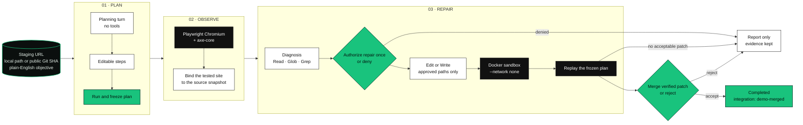
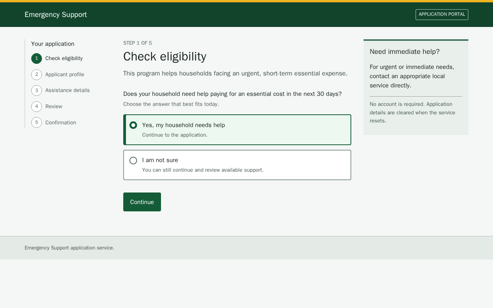
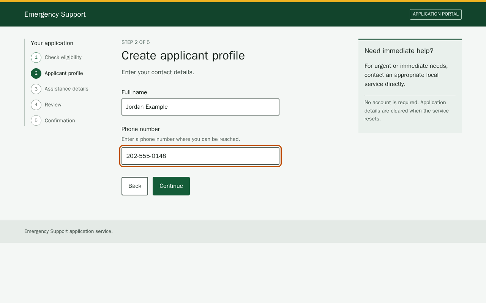
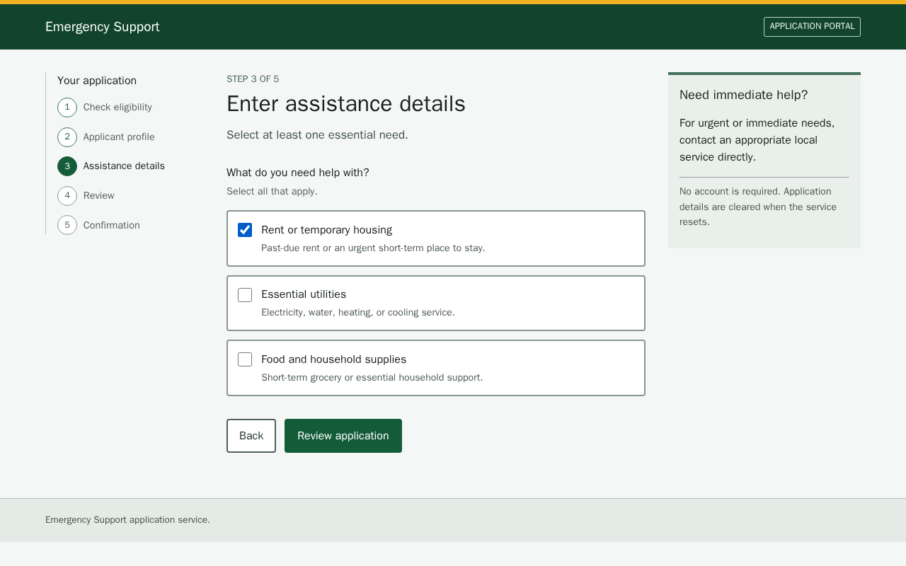
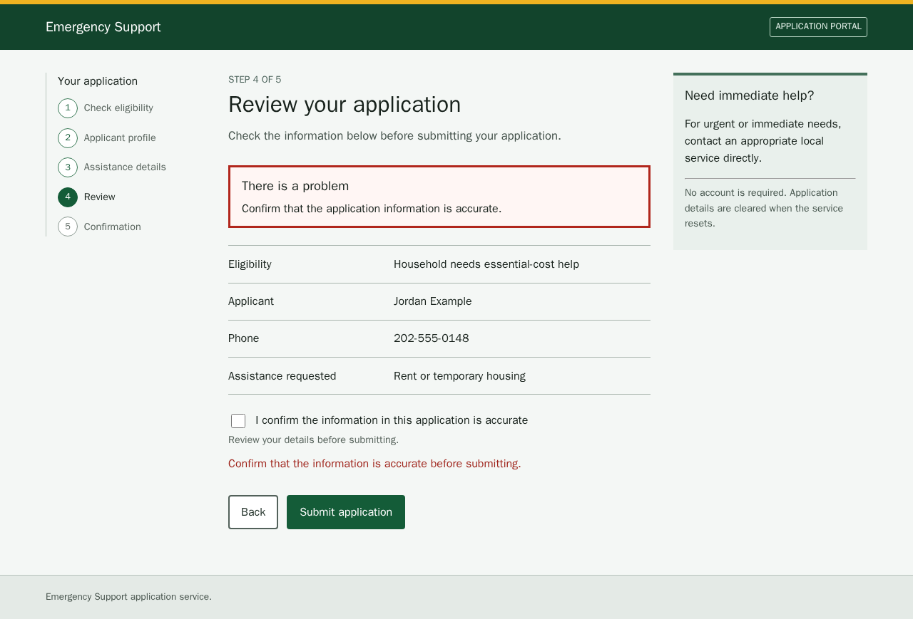
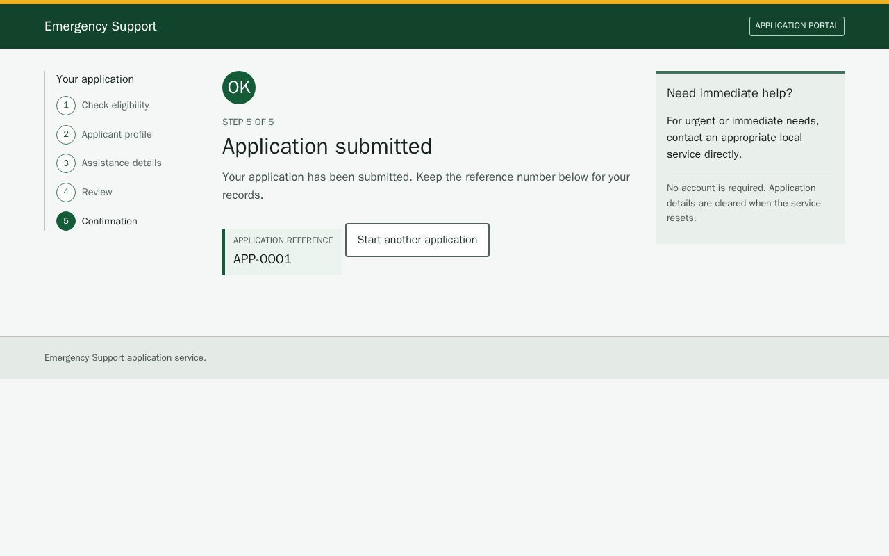

<p align="center">
  
</p>

<p align="center">
  <b>Run one critical web journey. Keep the evidence. Accept the patch yourself.</b><br/>
  <sub>Frozen browser plan → Playwright and axe-core → a scoped agent edit → Docker replay → an explicit accept.</sub>
</p>

<p align="center">
  
  
  
  
  
  
  
  
  
</p>

---

## ▍The problem

A page can collect a pile of rule violations and still block the action someone came to finish. The team then has to reproduce the failure, find the source, and show that the change fixed that action.

AccessPath runs one mission. You give it a staging URL, a source snapshot, and a plain-English objective. The Mission Workspace stays on one route and keeps a Proof Thread: Observed, Scoped repair, Verified, then the accept decision. Accessibility is the specialist this repository is built around. The host owns the browser, the commands, the evidence, and the verdict. The agent compiles, diagnoses, and edits only inside the turn it was given.

## ▍The pipeline at a glance



| Turn | Tools the policy allows | What it is for |
| --- | --- | --- |
| **Planning** | None | Turn the objective into steps you can edit |
| **Diagnosis** | `Read`, `Glob`, `Grep` inside the approved read scope | Explain the source. `Edit` and `Write` are denied |
| **Repair** | Those reads, plus `Edit` or `Write` on an approved path | One write needs an approval. A repeated write on the same path can reuse that session approval |

`AGENT_PROVIDER` selects the adapter. With the variable unset, the runner selects `qoder`. `.env.example` sets `openai`.

| `AGENT_PROVIDER` | Credential | Pinned default |
| --- | --- | --- |
| `qoder` | `QODER_PERSONAL_ACCESS_TOKEN`, or a local `qodercli` session | `@qoder-ai/qoder-agent-sdk` 1.0.16 |
| `openai` | `OPENAI_API_KEY` | `gpt-5-mini` via `https://api.openai.com/v1` |
| `qwen` | `OPENAI_API_KEY` or `QWEN_API_KEY` | `qwen3.7-max-preview` |
| `mock` | `ACCESSPATH_ENABLE_MOCK_PROVIDER=1` outside tests | Deterministic adapter. `npm run demo:verify` constructs this adapter itself |

The OpenAI adapter calls the Responses API and exposes AccessPath file tools only. The Qwen adapter blocks the SDK's shell and web tools and uses the same path policy. Browser actions, command execution, screenshots, axe results, and the replay verdict stay on the host.

Repair commands run in a digest-pinned `accesspath-sandbox:local` image. The container is created with `--network none`, `--cap-drop ALL`, and `no-new-privileges`. A replay counts when it writes a valid audit bundle at `ACCESSPATH_AUDIT_BUNDLE_PATH`. The process exit code does not. If Docker or that image is missing, preflight returns report-only and the mission keeps the evidence it already has.

`Merge verified patch` records acceptance and sets `integration` to `demo-merged`. It does not push, and it does not modify the base checkout.

## ▍The demo

`npm run dev` starts three loopback processes: the console, the companion, and a fictional emergency-aid application. The fixture task is a five-step application: eligibility, profile, assistance details, review, submit. Five findings are seeded in `apps/demo-aid-app/src/fixture-data.ts`. **AP-001** is the selected demo repair. **AP-002** through **AP-005** stay open in that manifest.

The stills below are those fixture pages. The console can attach them as demo evidence (`demo-evidence-ap-001` through `demo-evidence-ap-005`). They are not screenshots of the Mission Workspace.

<table>
<tr>
<td width="50%"><br/><sub><b>AP-001.</b> Eligibility. Seeded blocker: the choices are click-only elements, so a keyboard cannot select one. The scripted demo repair replaces them with native radios.</sub></td>
<td width="50%"><br/><sub><b>AP-002.</b> Applicant profile. Seeded check: the phone field has no <code>autocomplete="tel"</code>.</sub></td>
</tr>
<tr>
<td><br/><sub><b>AP-003.</b> Assistance details. Seeded check: the checkboxes are not in a named group.</sub></td>
<td><br/><sub><b>AP-004.</b> Review after a failed submit. Seeded finding: focus stays on Submit and the error summary does not link to the unchecked confirmation.</sub></td>
</tr>
<tr>
<td colspan="2"><br/><sub><b>AP-005.</b> Confirmation. Seeded finding: the new confirmation has no status role or live region. <code>APP-0001</code> is fixture data. The name field and phone number on these pages are the fixture values <code>Jordan Example</code> and <code>202-555-0148</code>.</sub></td>
</tr>
</table>

In the console, a mission is one route:

1. **Define new mission.** Staging URL, a local repository path or a public HTTPS Git URL plus a 40- or 64-character commit SHA, and an objective. Submit to generate an editable plan.
2. **Run and freeze plan.** The same action is labeled **Run mission plan** on the authorization panel before a grant exists.
3. **Authorize repair once** or **Deny repair.** Denial stops further source changes. Evidence already recorded stays visible.
4. Read the Proof Thread: **Observed**, **Scoped repair**, **Verified**.
5. **Merge verified patch** or **Reject patch.**
6. **Export report** writes HTML, Markdown, and JSON.

`docs/DEMO.md` is the judging runbook. Its click path still says "Run reviewed audit", "Open Barrier Map", and "Attach and create repair". Those labels are not in `apps/console/src`. The shipped surface is the Mission Workspace above. There is no Barrier Map component in the console.

`apps/companion/src/demo-ap001-fallback.ts` is a scripted adapter for the emergency-aid fixture. When the repair manifest is exactly AP-001 and the allowed paths match, it applies a known edit to the eligibility markup, the continue handler, and two fixture tests. It is the demo repair, not a general fixer.

## ▍Run it

Documented toolchain: Git 2.40 or newer, Node.js `20.19.0` from `.nvmrc` (engines also allow `^22.13.0` or `>=24`), npm, Playwright Chromium, and Docker for sandboxed repair. `npm run demo:verify` does not start Docker and does not call a live model.

```sh
npm install
npx playwright install chromium
npm run sandbox:build    # docker build -f docker/sandbox/Dockerfile -t accesspath-sandbox:local .
npm run dev
```

`npm run dev` loads `.env` when that file exists. Copy `.env.example`. Leave real tokens out of the repository. The runner prints the URLs it bound. Defaults, if the port is free:

| URL | Process |
| --- | --- |
| `http://127.0.0.1:5173` | Console. Open this one. |
| `http://127.0.0.1:4173` | Emergency-aid fixture |
| `http://127.0.0.1:4801` | Companion API. Loopback only. `ACCESSPATH_HOST` must stay `127.0.0.1` |

An occupied default port moves to the next free loopback port. `ACCESSPATH_DEV_CONSOLE_PORT`, `ACCESSPATH_DEV_COMPANION_PORT`, and `ACCESSPATH_DEV_DEMO_AID_APP_PORT` pin a port and exit nonzero when it is taken. When `accesspath-sandbox:local` exists, dev binds the companion to that image by its `sha256` id.

| Variable | Role |
| --- | --- |
| `ACCESSPATH_ARTIFACT_ROOT` | Absolute path outside the checkout. `demo:reset` and `demo:verify` default to `<home>/.accesspath/demo`. The companion defaults to `<home>/.accesspath` when the variable is unset. |
| `ACCESSPATH_PORT` | Companion listen port. `0` lets the OS choose. Dev sets an explicit port. |
| `AGENT_PROVIDER` | `qoder` (code default), `openai` (example file), `qwen`, or `mock` |
| `OPENAI_API_KEY`, `OPENAI_BASE_URL`, `OPENAI_MODEL` | OpenAI adapter. Also accepted as the Qwen key |
| `QWEN_API_KEY`, `QWEN_BASE_URL`, `QWEN_MODEL` | Qwen adapter. Forwarded by dev. Not listed in `.env.example` |
| `QODER_PERSONAL_ACCESS_TOKEN` | Optional Qoder PAT. A local `qodercli` session is the other supported login |
| `ACCESSPATH_DEMO_AGENT_INACTIVITY_TIMEOUT_MS` | Default `20000` |
| `ACCESSPATH_DEMO_AGENT_HARD_TIMEOUT_MS` | Default `90000`. Must be greater than or equal to the inactivity timeout |
| `ACCESSPATH_SANDBOX_IMAGE` | Optional image override. Dev prefers the local image id |

For the fixture, point Staging URL at the printed fixture origin and Local repository path at this checkout. The fixture goal in source is: check eligibility, create a profile, enter assistance details, review, and submit.

`demo:verify` requires a clean base checkout. It runs the audit-to-repair-to-replay path on the mock adapter. `workspace:reset` and `demo:reset` are the same script: they delete AccessPath-owned artifact directories and temporary repair branches. They leave the main checkout, its branches, and its commits alone.

```sh
npm run demo:reset
npm run demo:verify
```

```sh
npm run lint
npm run typecheck
npm run test
npm run test:security
npm run test:a11y
npm run test:e2e
```

`npm run test:qoder:live` is the optional Qoder SDK smoke (`--provider qoder`). `npm run test:agent:live` is the same script without that flag, so it follows `AGENT_PROVIDER`. Either exits nonzero when the selected provider has no credentials. That does not block `demo:verify`.

`docs/SETUP.md` records the same install in PowerShell, including the interactive click list from the earlier console. Prefer the control names in this file when they differ.

## ▍Repository map

```
AccessPath/
├── apps/
│   ├── console/                 React + Vite Mission Workspace
│   ├── companion/               Fastify API, missions, Docker sandbox
│   └── demo-aid-app/            Fictional emergency-aid fixture
├── packages/
│   ├── contracts/               Zod schemas and shared types
│   ├── audit-engine/            Playwright context, axe-core, findings
│   ├── evidence/                Artifact store, redaction, HTML/Markdown/JSON reports
│   ├── git-workspace/           Snapshots, worktrees, diffs
│   └── qoder-runner/            Qoder, OpenAI, Qwen, and mock adapters
├── docker/sandbox/              Playwright image for repair commands
├── scripts/                     dev runner, demo reset/verify, live smoke
└── docs/                        Product, architecture, security, demo runbook
```

Runtime artifacts are files under the artifact root, outside the repo. There is no database.

| Doc | |
| --- | --- |
| [PRODUCT.md](PRODUCT.md) | Who it is for, and the mission contract |
| [DESIGN.md](DESIGN.md) | Visual system for the console |
| [docs/ARCHITECTURE.md](docs/ARCHITECTURE.md) | Planes, trust boundaries, module ownership |
| [docs/DECISIONS.md](docs/DECISIONS.md) | Fixed decisions. Overrides the other docs when they conflict |
| [docs/API_CONTRACTS.md](docs/API_CONTRACTS.md) | API, events, persisted artifacts |
| [docs/SECURITY.md](docs/SECURITY.md) | Threat model and permission boundaries |
| [docs/SETUP.md](docs/SETUP.md) | Manual setup and troubleshooting |
| [docs/DEMO.md](docs/DEMO.md) | Judging script. Button labels predate the current console |
| [docs/TEST_PLAN.md](docs/TEST_PLAN.md) | Validation gates |
| [docs/SUBMISSION.md](docs/SUBMISSION.md) | Hackathon submission notes |

## ▍What this is, and isn't

We'd rather be precise than impressive.

- A finished mission records one Chromium journey, the checks that ran, and the patch decision. It is not a site-wide audit and it is not a WCAG conformance claim. AccessPath's own UI targets WCAG 2.2 AA; that target is separate from the site under test.
- The emergency-aid application is fictional local fixture data. Its five findings are seeded. AP-001 is the scripted repair. The other four are written to remain.
- `npm run demo:verify` proves the mock-backed path. It does not prove a live Qoder, OpenAI, or Qwen session.
- The AP-001 fallback adapter edits a known file set. It runs only when the manifest is that finding and the paths match.
- Without Docker, or without the digest-pinned sandbox image, command execution stays report-only. Preserved evidence remains reviewable. The mission does not gain an acceptable source patch from a missing replay.
- The accept control records `demo-merged` on the mission. Git push, remote changes, and edits to the base checkout are outside the product.
- `docs/DECISIONS.md` still names a Barrier Map as the defining surface, with a linear alternative. The console in this repository does not render one.
- This repository contains no usage metrics, testimonials, or benchmark numbers. It also has no `LICENSE` file.

## ▍Credits

| | |
| --- | --- |
| Browser evidence | [Playwright](https://playwright.dev/) 1.62.0 and [axe-core](https://github.com/dequelabs/axe-core) 4.12.1 |
| Console | [React](https://react.dev/) 19, [Vite](https://vite.dev/) 8, [Lucide](https://lucide.dev/) |
| Companion | [Fastify](https://fastify.dev/) 5 |
| Contracts | [Zod](https://zod.dev/) |
| Repair agents | [@qoder-ai/qoder-agent-sdk](https://www.npmjs.com/package/@qoder-ai/qoder-agent-sdk) 1.0.16, OpenAI Responses API, [@qwen-code/sdk](https://www.npmjs.com/package/@qwen-code/sdk) 0.1.8 |
| Isolation | Docker, Git worktrees under the artifact root |
| Fixture | Written in this repository. No real applicant data |
| History | Commits on this repository are `bede-lau` |
| Event | [docs/SUBMISSION.md](docs/SUBMISSION.md) names the Alibaba Cloud x Qoder Hackathon Singapore 2026. The deadline written there is Wednesday, 5 August 2026, 11:30 PM GMT+8. Official page linked from that doc: https://luma.com/92h6pyl1 |

<p align="center"><sub>Local-first mission workspace. Evidence stays a file. The patch waits for a person.</sub></p>
