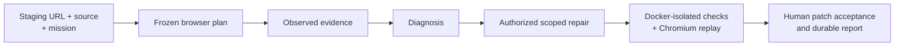

<h1 align="center">AccessPath</h1>
<p align="center"><b>Turn a critical web journey into evidence, a scoped repair and a verified proof thread.</b></p>

<p align="center">
  
  
  
  
</p>

## ▍Project gallery

<table><tr>
<td width="50%"></td>
<td width="50%"></td>
</tr></table>

<sub>Images from the [project portfolio](https://bede-lau.github.io/); they may depict an earlier build.</sub>


## ▍At a glance



The host owns browser actions, permissions and verification. Missing replay evidence leaves a mission report-only.

---

AccessPath is an autonomous critical-journey QA workspace for web applications,
with accessibility as its flagship specialist. A mission connects a staging
URL, a source snapshot, and a plain-English objective into one continuous Proof
Thread: observed behavior, scoped repair, and verified evidence.

## ▍Proof thread and trust boundaries

A mission keeps the objective and source snapshot attached to what the browser actually observed. The host compiles a plan, records evidence, constrains any repair to authorized paths, and checks the result in a separate workspace.

| Stage | Evidence or authority |
| --- | --- |
| **Freeze** | Staging target, source snapshot, objective, viewport and success conditions establish the mission context. |
| **Observe** | Playwright, accessibility, console and network artifacts are recorded as observations; agent interpretations remain separate. |
| **Diagnose and repair** | Qoder diagnosis is read-only; editing is limited to explicitly approved paths and operations. |
| **Replay** | Authorized commands run in a digest-pinned Docker image without runtime network. A command exit code alone does not establish reproduction: replay must persist a valid audit bundle. |
| **Accept** | The reviewer inspects the source patch and evidence before acceptance. Missing replay evidence leaves the outcome report-only. |

### Repository map

| Path | Role |
| --- | --- |
| [`apps/console`](apps/console) | Mission workspace and browser-facing interface |
| [`apps/companion`](apps/companion) | Local companion and orchestration |
| [`packages/contracts`](packages/contracts) | Shared contracts |
| [`packages/audit-engine`](packages/audit-engine) | Audit execution |
| [`packages/evidence`](packages/evidence) | Evidence records |
| [`packages/git-workspace`](packages/git-workspace) | Source workspace boundary |
| [`packages/qoder-runner`](packages/qoder-runner) | Qoder integration |
| [`docker/`](docker/) | Sandbox image and related configuration |

The accessibility target is a design goal; the documentation does not claim legal compliance or production certification.

---


## Prerequisites

- Node.js 20.19+ (see `.nvmrc`)
- npm
- Git
- Playwright Chromium
- Docker Desktop for repair and repaired-preview verification

## Quick Start

```powershell
npm install
npx playwright install chromium
npm run sandbox:build
npm run dev
```

Open the console URL printed by `npm run dev`, normally
`http://127.0.0.1:5173`. The local target application and companion start with
it. When `accesspath-sandbox:local` is available, the development runner binds
the companion to that image by its immutable content ID. Occupied default
backend ports are replaced with the next available loopback ports and printed
in the terminal.

## Verification

```powershell
npm run lint
npm run typecheck
npm run test
npm run test:security
npm run test:a11y
npm run test:e2e
npm run workspace:reset
npm run demo:verify
```

## Current Status

The Mission Workspace MVP supports a frozen plain-English browser plan, direct
staging evidence, Qoder diagnosis and authorized source editing, Docker-isolated
commands and Chromium replay, explicit patch acceptance, and durable reports.

- Qoder compiles the mission plan with no tools, diagnoses with read-only
  tools, and repairs only approved exact paths with `Edit` or `Write`.
- `npm run test:qoder:live` is the optional real-SDK smoke test. It requires
  `QODER_PERSONAL_ACCESS_TOKEN` or a local `qodercli` session and exits nonzero
  when neither is available.
- The host owns browser actions, permissions, commands, evidence, and
  verification. Missing replay evidence leaves a mission report-only.
- `npm run workspace:reset` removes AccessPath-owned artifacts and temporary
  repair branches. It does not reset the main checkout, normal branches, source
  files, or their commits.

## Documentation

See `PRODUCT.md` and `DESIGN.md` for the Mission Workspace product and
interaction contracts.
