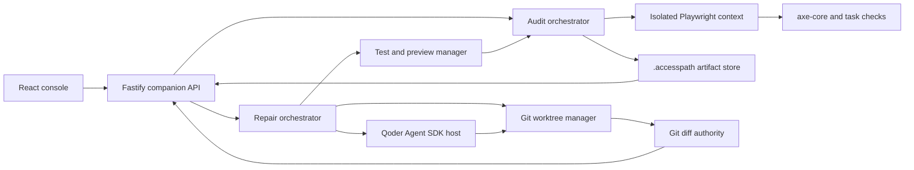
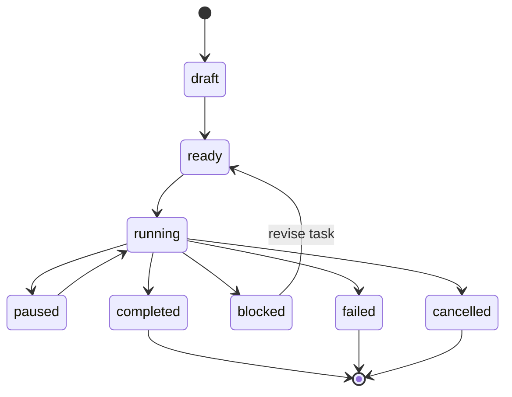
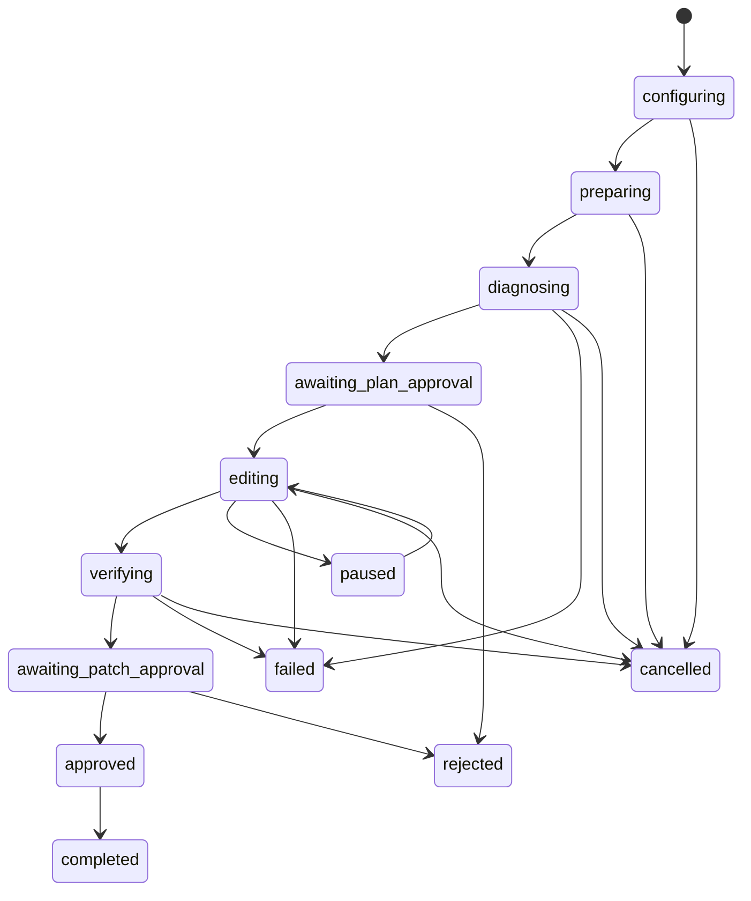

# Architecture

## Status and authority

- Status: implementation contract
- Architecture: local-first modular monolith
- Runtime: Node.js 20 or newer
- Source of truth: `DECISIONS.md` overrides this document

AccessPath has two logical planes:

1. The **audit plane** executes an untrusted web application and creates a
   repository-independent evidence bundle.
2. The **repair plane** receives explicit authority over an isolated local Git
   worktree and asks Qoder to make a bounded repair.

They share a local API and artifact store, but they do not share ambient
authority. Browser content must never become shell instructions, and an audit
must work without a repository or Qoder authentication.

## Runtime topology



The Vite development server may proxy `/api` to Fastify during development.
For the packaged demo, Fastify should serve the built console and bind only to
`127.0.0.1` on a random available port.

## Trust boundaries

| Boundary | Owns | Must not own |
|---|---|---|
| React console | Presentation, navigation, user decisions | Shell, Git, Qoder token, arbitrary filesystem access |
| Companion API | State machines, policy, event sequencing | Unbounded agent autonomy |
| Browser worker | Navigation, interactions, screenshots, axe scans | Repository access, Qoder credentials |
| Qoder host | SDK session and approved tool mediation | Base checkout or unrelated paths |
| Git workspace | Worktrees, diffs, snapshots, cleanup | Agent diagnosis or browser state |
| Artifact store | Structured evidence and hashes | Raw passwords, cookies, tokens, form secrets |

## Repository layout

```text
accesspath/
  apps/
    console/
      src/
        app/
        components/
        features/audits/
        features/barrier-map/
        features/repairs/
        features/evidence/
        lib/
    companion/
      src/
        server.ts
        routes/
        services/
        policy/
        process/
    demo-aid-app/
      src/
      tests/
  packages/
    contracts/
      src/
    audit-engine/
      src/
    qoder-runner/
      src/
    git-workspace/
      src/
    evidence/
      src/
  docs/
  .accesspath/
  package.json
  tsconfig.base.json
```

Dependency direction:

```text
contracts
  <- audit-engine
  <- evidence
  <- git-workspace
  <- qoder-runner
  <- companion
  <- console
```

Packages may depend on `contracts`; lower-level packages must not import from
applications. The console consumes generated or shared contract types and
never imports server implementation code.

## Core modules

### Contracts

Owns versioned Zod schemas, TypeScript types, state enums, API inputs, event
envelopes, error codes, and artifact manifests. Persisted data is parsed at
every boundary.

### Audit engine

Owns:

- target policy validation
- Playwright context lifecycle
- bounded task execution
- evidence checkpoints
- axe-core invocation
- screenshots and accessibility snapshots
- finding normalization
- cancellation and timeouts

It returns an `AuditBundle`; it does not know about Git or Qoder.

### Evidence

Owns transformation from low-level observations to human-action findings,
Barrier Map data, comparison results, integrity hashes, and Markdown/HTML
reports. It must preserve links to source artifacts.

### Git workspace

Owns repository validation, clean-base checks, branch and worktree creation,
canonical path checks, status, diff, snapshots, and cleanup. Git output is the
authority for what changed; SDK activity is explanatory telemetry.

### Qoder runner

Owns SDK authentication, session lifecycle, streaming conversion, tool policy,
approval requests, checkpoint metadata, interruption, and rewind preview. It
receives a repair manifest, never an unrestricted dump of browser content.

### Companion

Owns REST routes, SSE streams, state transitions, process supervision, artifact
paths, redaction, preview lifecycle, and orchestration across packages.

### Console

Owns audit setup, live evidence, Barrier Map, repair review, agent timeline,
approvals, diff inspection, verification, rewind, and export.

## Audit contract

A task is bounded by a `TaskContract`:

```ts
type TaskContract = {
  id: string;
  title: string;
  goal: string;
  startUrl: string;
  targetPolicy: "public" | "local-explicit";
  success: {
    urlMatches?: string;
    visibleText?: string;
    selector?: string;
  };
  forbiddenActions: string[];
  expectedSteps: Array<{
    id: string;
    intent: string;
    action:
      | { kind: "click"; role: string; name: string }
      | { kind: "fill"; label: string; valueRef: string }
      | { kind: "select"; label: string; option: string }
      | { kind: "press"; key: string }
      | { kind: "assert"; text: string };
  }>;
  viewport: { width: number; height: number };
  timeoutMs: number;
};
```

MVP task execution uses reviewed steps. Qoder may help draft or explain the
steps, but the deterministic runner executes the approved contract.

At each stable step, collect:

- attempted action and observed result
- URL and page title
- screenshot
- relevant locator and accessible name
- focused element and keyboard state
- axe-core results
- concise console and failed-request summaries
- success, barrier, ambiguity, or policy outcome

## Audit lifecycle



Every terminal run produces a bundle, including partial evidence and a failure
diagnostic when the task does not complete.

## Plane boundary: AuditBundle

`AuditBundle` is portable, versioned, and independent of a live browser
session. It includes the task contract, ordered steps, normalized findings,
artifact references, environment, outcome, limitations, and integrity hashes.
It excludes credentials, cookies, raw authorization headers, and submitted
secret values.

The repair plane consumes only a validated bundle plus the user's repository
configuration.

## Repair lifecycle



Required sequence:

1. Validate repository and require a clean base checkout for the MVP.
2. Record base branch, base commit, start command, and test commands.
3. Create `accesspath/<repair-id>` in an application-owned worktree directory.
4. Create a repair manifest from selected findings and evidence references.
5. Start Qoder with the worktree as its working directory.
6. Run read-only diagnosis and emit a concrete plan.
7. Require approval before the first mutation.
8. Stream normalized agent and tool events.
9. Refresh Git status and diff after file events.
10. Start or refresh the preview from the worktree.
11. Run repository-native tests.
12. Replay the original task contract against the preview URL.
13. Classify each selected finding as resolved, remaining, regressed, or
    unverified.
14. Require patch approval before marking the session complete.

## Qoder SDK policy

Use the official TypeScript SDK with:

- working directory set to the generated worktree
- file checkpointing enabled
- session ID persisted
- streamed messages converted to AccessPath events
- read/search tools pre-authorized within the worktree
- edit/write and allowlisted commands brokered by policy
- external network, deployment, Git push, and path escape denied
- interruption and file rewind exposed through explicit API commands

Do not expose model chain-of-thought. Display phases, messages intended for the
user, tool requests, target paths, command output, results, and errors.

Qoder checkpoint data supports rewind, but Git remains the canonical diff and
repository-state authority. Rewind must be previewed first and must warn that
file rewind cannot undo command side effects.

## Event architecture

REST accepts commands; SSE emits ordered state.

Each event has a monotonically increasing sequence within a session. The
console reconnects with `Last-Event-ID`; the server replays events after that
sequence before streaming live events. Events are append-only NDJSON.

State changes must be committed to disk before the matching event is emitted.
Event consumers must tolerate duplicate delivery by event ID.

## Artifact store

```text
.accesspath/
  config.json
  audits/<audit-id>/
    session.json
    events.ndjson
    bundle.json
    artifacts/<sha256>.<ext>
    report.md
    report.html
  repairs/<repair-id>/
    session.json
    events.ndjson
    manifest.json
    approvals.json
    tests.json
    comparison.json
  worktrees/<repair-id>/
```

Writes use temporary files plus atomic rename. Large binary artifacts are
content-addressed. Relative paths are stored; absolute repository paths are
not exported.

## Process supervision

The companion owns every browser, preview, test, and SDK child process it
starts. Each process records PID, command category, start time, timeout, and
session. Cancellation terminates the full owned process tree and leaves
inspectable artifacts.

Preview commands are configured by the user and parsed into executable plus
arguments. Do not execute through an interpolating shell when avoidable.

## Failure behavior

| Failure | Required outcome |
|---|---|
| Navigation, TLS, or DNS failure | Failed audit with diagnostic |
| Ambiguous step or missing success signal | Blocked; request task revision |
| Prohibited redirect | Abort and record policy event |
| Dirty base checkout | Refuse repair without modifying files |
| Worktree creation failure | Preserve base repository; return Git diagnostic |
| Qoder authentication failure | Pause or fail safely; retain resumable state |
| SSE disconnect | Resume from stored sequence |
| Preview or test timeout | Kill owned process tree and preserve output |
| Rewind unavailable | Show the SDK error; do not improvise a reset |
| Verification unavailable | Mark result unverified |

## Future adapters

The following interfaces should be injectable without being generalized early:

- `AuditRuntime`: local Playwright now, isolated cloud worker later
- `ArtifactStore`: filesystem now, object storage later
- `EventStore`: NDJSON now, durable database later
- `RepairProvider`: Qoder SDK now, no generic provider UI required

A future cloud audit adapter may accept public HTTPS targets only. Localhost,
private staging, repositories, credentials, and repair remain local.

## Architecture acceptance criteria

- Audit completes without a repository or Qoder token.
- Every repair mutation stays under the generated worktree root.
- The base checkout status and commit remain unchanged.
- Browser content has no direct path to shell execution.
- Events reconnect exactly once in order from a known sequence.
- Verification reuses the original task contract.
- Every session reaches a terminal or explicitly paused state.
- Exported bundles contain no secrets or absolute local paths.
